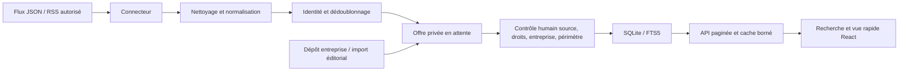

# Plan d’implémentation et architecture

## 1. Données, catalogue et ingestion

Implémenté :

- `Company` enrichi : identité, type, effectif déclaré, ville, implantations/agences, stack déclarée, rythme accepté, labels/certifications, expertises, logo autorisé et contact générique RH/tutorat. Chaque enrichissement exige une page de provenance et devient public après revue. Un champ manquant reste nul ou vide.
- Annuaire initial de 19 pistes d’entreprises, dont 12 ESN ou spécialistes supplémentaires (SFEIR, Zenika, Smile, Niji, Apside, Clever Cloud, Sewan, Wifirst, CELESTE, Synacktiv, Quarkslab, Koesio). Aucune taille PME, agence, stack ni annonce courante n’est présumée ; « PME » et « Start-up » sont des types disponibles pour les fiches documentées.
- SQLite `companies`, `offers`, relations de technologies/formations, recherche FTS5 et journal `ingestion_runs`. Le modèle complet est dans `server/models.d.ts`, le schéma dans `server/schema.sql`.
- Adaptateurs JSON et RSS/Atom indépendants du stockage et de l’interface. Nettoyage HTML, retrait des adresses e-mail dans le texte importé, extraction lexicale de technologies, niveaux et villes _mentionnés_. Les propositions ne remplacent jamais les données structurées de la source ni une exigence confirmée.
- Empreinte titre/entreprise/ville et URL canonique pour dédoublonner. Identité source + identifiant externe et empreinte de contenu pour rejouer les collectes. Une modification remet l’offre en attente et efface sa vérification, en conservant la première récupération. Un retrait manuel n’est pas annulé par une collecte.

La récupération d’un flux n’est jamais une vérification. Le badge est daté, expire après sept jours, et mentionne le périmètre technique uniquement si celui-ci a été relu. Une date de mise à jour source est distinguée de la réception dans le catalogue. Dares publie notamment des statistiques et ne doit pas être présenté comme un flux de postes à pourvoir. France Travail dispose désormais d’un connecteur OAuth conditionné à ses habilitations et variables serveur ; voir `FRANCE_TRAVAIL.md`. RapidAPI reste un test privé, sans import actif ni scraping de LinkedIn.

## 2. Recherche et vitesse

Implémenté :

- Index SQLite sur état/publication, région/contrat, ville, domaine, entreprise et tables technologies/formations. FTS5 Unicode insensible aux accents ; requêtes paramétrées et syntaxe de recherche générée depuis des mots, jamais concaténation de SQL utilisateur.
- Filtres serveur combinables : `query`, `city` (préfixe normalisé), `tech` (mention exacte), `region`, `domain`, `group`, `education`, `contract`, `age`, `companyId`. Tri par vraie date source lorsque le flux fournit l’heure.
- Pages publiques de 20 offres, plafond 50 ; fiches et annuaire paginés à 12 entreprises ; modération paginée à 20 dépôts avec compteurs globaux. Le total correspond à l’ensemble du filtre, pas à la page.
- Listes résumées ; description intégrale, missions et contacts chargés lors de l’ouverture d’une offre. Vue rapide sans recharger la page.
- Cache mémoire LRU borné à 200 entrées, TTL 15 secondes. Invalidation locale après mutation et détection des écritures d’une autre connexion avec `PRAGMA data_version`. Le cache des offres ne traverse pas la première échéance du résultat ; les statuts de vérification sont recalculés à la lecture. Les fiches et compteurs entreprises peuvent avoir au plus 15 secondes de retard sur une échéance temporelle.
- Debounce de 200 ms et annulation des recherches obsolètes dans le navigateur. Cache statique d’un an uniquement pour les assets hashés ; compression HTTP des réponses volumineuses. Les réponses API restent `no-store` côté navigateur pour ne pas conserver des offres retirées.

SQLite WAL prend en charge plusieurs connexions sur **le même disque local**. Il ne constitue pas une base distribuée pour plusieurs instances sur des machines différentes. Pour une croissance horizontale, migrer le repository vers PostgreSQL et remplacer le cache/processus planifié par un cache et une file partagés. Pas de promesse de latence universelle : mesurer sur le volume et l’hébergement réels.

## 3. Interface et continuité

Implémenté :

- Police Inter auto-hébergée (OFL), sans requête Google Fonts à l’exécution ; palette sobre conservée.
- Skeletons, pagination accessible, filtres ville/technologie, tags techniques lisibles et badge explicite de contrôle humain.
- Écrans employeur/modération chargés à la demande. Logos facultatifs uniquement s’ils sont autorisés, dimensions réservées, `loading="lazy"`, décodage asynchrone et absence de logos tiers ajoutés d’office.
- Annuaire indépendant des résultats de recherche, filtres entreprise/type/taille/ville/expertise, fiche complète et offres liées avec pagination.
- Favoris et alertes locaux préservés. Le nombre de correspondances d’une alerte est demandé au serveur, indépendamment de la page actuellement affichée. Un favori indisponible ne reçoit pas de nouvelle validation ; le lien source reste accessible.

## Migration et exploitation

Au premier démarrage, les dépôts de `DATA_DIR/offers.json` sont importés **dans une transaction** vers `catalogue.sqlite`. Le JSON d’origine est laissé intact. Les identifiants, premières récupérations, états et vérifications existants sont conservés. Un marqueur empêche de rejouer la migration. Une erreur arrête le démarrage au lieu d’ignorer les données. Les écritures suivantes utilisent uniquement SQLite ; modifier l’ancien JSON n’a plus d’effet. Sauvegarder avant déploiement et conserver une sauvegarde SQLite avec une méthode cohérente (API `backup` SQLite ou sauvegarde disque arrêtée), pas une copie isolée d’un fichier actif sans son WAL.

L’application ajoute une base solide pour un pilote en production, pas toutes les fonctions d’un SaaS multi-utilisateur : l’administration reste protégée par un jeton serveur unique ; les comptes, MFA, rôles, e-mails, facturation et observabilité externe ne sont pas implémentés. Aucun paiement ni abonnement n’a été ajouté.

## Actualisation v0.3.1 — source LBA et catalogue livré

Un instantané daté de 47 offres d’alternance LBA est désormais chargé au démarrage. La sélection source fonctionne sans badge humain, avec une politique spécifique « active dans l’API, disponibilité à confirmer ». Les anciennes annonces sont incluses à la demande explicite du responsable ; les dépôts et flux génériques conservent les règles de modération précédentes. Les sites d’entreprise absents sont laissés nuls, et les deux types de contrats sont indexés lorsqu’ils sont tous deux acceptés. La table `offer_contracts` et son index permettent ce filtrage sans perdre le second type de contrat. La date exacte d’expiration source prime sur l’échéance interne.

L’intégration ne donne aucun droit de monétisation : voir `config/DATA_LICENSE.md`. Les données de test/sandbox et les entreprises à candidature spontanée sont exclues. Une reprise de l’instantané ne peut pas écraser un état plus récent ou annuler un refus/retrait manuel. La source LBA est choisie par défaut si sa clé est disponible et qu’aucun fichier de sources personnalisé n’est configuré ; la périodicité par défaut devient trois heures avec cette clé. Sans clé côté déploiement, le site sert uniquement l’instantané daté.

## Annuaire et critères d’accueil

La mise à jour de l’annuaire est décrite dans [COMPANY_CATALOGUE.md](COMPANY_CATALOGUE.md) : 56 fiches initiales, provenance par champ, distinction identité/accueil/offres, revue privée datée, critères périssables, FTS5 et filtres indexés. Le plan par étapes, les limites de vérification et les mesures locales y sont consignés.

## Google Jobs autonome

Le serveur démarre `SerpApiAutomation`, indépendamment de la navigation privée. Les recherches stage/alternance couvrent les domaines du catalogue dans une rotation persistante et bornée. La classification explicite, la résolution de communes françaises et les dates source autorisent uniquement les publications admissibles, sans badge humain. Le suivi privé est en lecture seule. Voir [le module et ses limites](SERPAPI.md).
